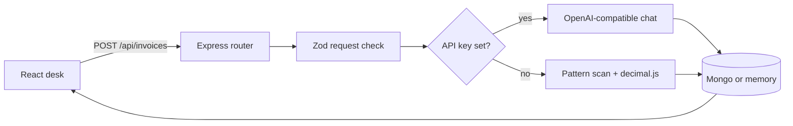

# Developer notes

This file is the map of the code. Read it before changing a route or the prompt. The product explanation for someone running the app is in [README.md](README.md).

## Shape

Two packages, one repo, npm workspaces.

```text
client/     React + Vite + Tailwind. Talks only to /api.
server/     Express. Owns validation, the model, and storage.
```

The client does not import server files. The invoice contract is duplicated in `client/src/types.ts` and `server/src/types.ts` on purpose. A shared package would be a third workspace for one interface. If you add a field, change both types and the Zod schema that actually enforces the model output.



## Request path

1. `client/src/App.tsx` submits the form through `client/src/api.ts` (axios).
2. `server/src/routes/invoices.ts` parses the body with `invoiceRequestSchema`. A failed parse is a 400 with one sentence, not the raw Zod tree.
3. `extractInvoice` in `server/src/ai/invoice.ts` either calls the model or `heuristicInvoice`.
4. After the model (or heuristic) returns fields, the server uses decimal.js to sum line item amounts and compare to the stated total. The flag is stored on the result.
5. The store inserts the input plus the result. The response is the saved record, including its id, so the UI can select it without a second fetch.
6. Errors from the store or an unexpected throw hit the handler in `server/src/app.ts` and become a 500 `{ error }`.

`GET /api/health` is how the header knows whether it is showing a model name or the words "offline extraction". The handler does not return the API key.

## Model contract

`modelResultSchema` is the only shape we accept from a model:

- `vendor`, `invoiceNumber`, `issueDate`, `currency`, `statedTotal`, `summary` strings
- `dueDate` optional string
- `lineItems` array of `{ description, quantity?, unitPrice?, amount }`

`source`, `model`, `computedTotal`, and `totalsMatch` are set by our code after parsing. The model is not allowed to claim it is the offline checker, and the offline checker is not allowed to claim it is a model.

Flow inside `fromModel`:

1. Ask with `response_format: json_object`.
2. If that flag is rejected by the provider, retry the same prompt without it.
3. Strip optional markdown fences in `extractJson` and run Zod.
4. On invalid JSON, ask once more, quoting a clipped reason.
5. If that still fails, or the HTTP call fails, return the heuristic result and put the failure in the summary. The user still gets a saved invoice, and the badge still says the result is offline.

The system prompt's important rule: only extract what is written. Never invent vendors, numbers, dates, or line items. That is the behavior you should be able to defend in an interview. The code does not have a second checker that proves the model obeyed. Zod checks shape, not truth.

Temperature is `0.2` so repeated runs on the same invoice stay closer.

After a successful parse we always recompute the total with decimal.js. Binary floats are never used for money.

## Offline checker

`heuristicInvoice` is not a miniature model. It does four things:

- Looks for invoice number, date, due, vendor, and total phrases.
- Collects lines that contain a money amount and are not totals as line items.
- Sums the line item amounts with decimal.js.
- Sets `totalsMatch` by comparing the sum to the stated total.

If nothing useful matches, the summary says the scan found limited structure.

## Storage

`InvoiceStore` in `server/src/types.ts` is the seam: `insert`, `list`, `get`, `remove`.

- `createMemoryStore` keeps an array in the process. Newest first. Used when `MONGO_URI` is empty so `npm run dev` works with zero infrastructure. Data dies with the process. Say that out loud if you demo it.
- `createMongoStore` connects with Mongoose and maps `_id` to `id` at the edge. Callers never see an ObjectId. Invalid ids return null instead of throwing, so a bad id is a 404.

`connectStore` is the only place that chooses. Routes take an `InvoiceStore`, which is why `memory.test.ts` does not need a database.

Documents are not user-scoped. There is no account system. Do not store real invoices on a shared server until that exists.

## UI

`App` holds the form and the selected invoice id. The list of invoices comes from React Query (`queryKey: ["invoices"]`). After a create or delete the mutation invalidates that key. There is no second copy of the server list in `useState`.

`Load sample` fills the same field a person would paste. It does not skip the API.

Timestamps the user sees are formatted with date-fns (`formatWhen`, `formatRelative`, `tryFormatDate`).

Styles are Tailwind utilities. There is no hand-written CSS design system.

## Library notes

Interviewers still say "moment". Moment is legacy, mutable, and heavy; this repo uses date-fns.

`formatWhen` in `server/src/dates.ts` (and the matching helper on the client) calls `format(parseISO(iso), "PPp")`. For the input `2026-03-15T14:30:00.000Z` it returns a localized string such as "Mar 15, 2026, 2:30 PM" (exact text depends on the locale of the Node process).

- **Tailwind CSS** (`@tailwindcss/vite`): all UI styling. Used in `client/src/App.tsx` via utility classes. Answers "how do you style a React app without a large CSS file?"
- **date-fns**: every timestamp the user sees. `formatWhen` / `formatRelative` / `tryFormatDate` in `client/src/dates.ts` and `server/src/dates.ts`. Answers the moment question above.
- **axios**: every API call. `client/src/api.ts`. Answers "why not raw fetch?" — consistent error handling and interceptors if we add them later.
- **TanStack Query**: loading, creating, and deleting server data. `useQuery({ queryKey: ["invoices"] })` and `invalidateQueries` after writes in `client/src/App.tsx`. Shows `isPending`. Answers "how do you keep the list in sync without a second useState copy?"
- **Zod**: request bodies and model JSON on the server. `invoiceRequestSchema` and `modelResultSchema` in `server/src/ai/schema.ts`. Answers "how do you validate untrusted JSON?"
- **helmet**: basic Express security headers. `app.use(helmet())` in `server/src/app.ts`. Answers "what is the first middleware you add to Express?"
- **cors**: already required for the Vite proxy. `app.use(cors())` in the same file.
- **decimal.js**: all money arithmetic. `computeTotal` in `server/src/ai/heuristic.ts` and the post-model check in `server/src/ai/invoice.ts`. Answers "why not native numbers for currency?" — binary floats cannot represent 0.1 exactly.

Redux Toolkit is for a large shared client cache this app does not have. React Query owns the server list.

## Tradeoffs

- In-memory fallback makes the repo runnable in a portfolio review. It is the wrong store for anything private or multi-instance.
- Falling back to the heuristic when the model fails keeps the demo alive. It can also hide a bad key. The summary string is the signal. The health badge is the other one.
- Duplicated types will drift if you only edit one side. The API response is the runtime contract. TypeScript will not catch a client that forgot a new field until you use it.
- `Mixed` for the Mongo result is deliberate. The result shape is owned by Zod at write time. A rigid Mongoose subschema would reject old rows the moment the JSON gained a key.
- decimal.js adds a dependency for one critical invariant. The alternative (string math or a custom fixed-point type) is more code for the same guarantee.

## Interview walkthrough

If someone asks you to explain this repo, walk this path and stop where they interrupt:

1. The UI never calls a model. It only posts text to Express.
2. Zod rejects short or huge payloads before any token is spent.
3. The model must return JSON. We parse it, check it, and retry once.
4. We label heuristic results so a missing API key cannot look like GPT.
5. Mongo is optional behind a store interface. Tests hit the memory implementation.
6. There is no auth, so the README tells you not to deploy it with real invoices.
7. Dates are formatted with date-fns, not Moment.
8. Money sums use decimal.js so 0.1 + 0.2 is exactly 0.30.

## What I would not add next without a reason

Login, OCR for PDF invoices, multi-currency conversion, or a payment gateway. Each one is a new product. The current gap that matters is truthfulness of the extraction, not more screens.
